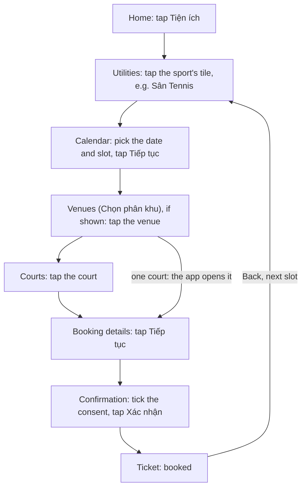
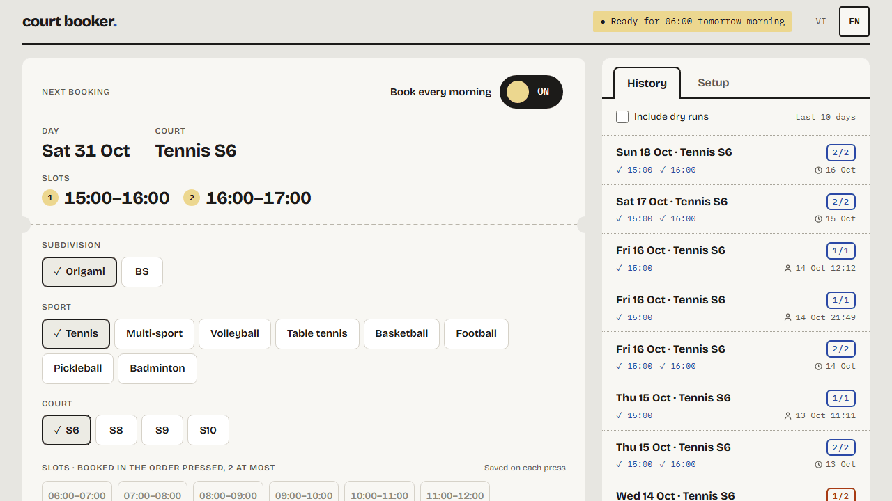
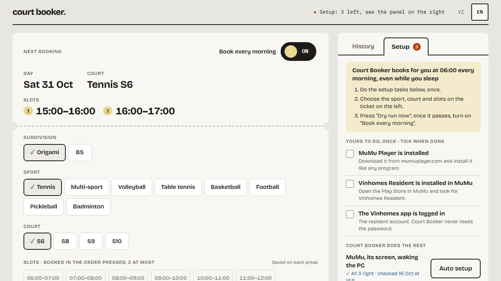

# vh-tennis-booker

[](https://github.com/servedbyhau/vh-tennis-booker/actions/workflows/ci.yml)


Books a court (tennis, or another sport: a multi-purpose court, volleyball, table tennis,
basketball, football, pickleball, badminton, as the subdivision offers them; Origami and BS
so far) the moment bookings open. The Vinhomes Resident app opens each day's
courts at 06:00, and the popular slots are gone within seconds. This project books them
while its owner sleeps: a Windows scheduled task wakes the PC, starts the MuMu Player
emulator and taps through the app's own booking screens with Python and an Android
instrumentation driver, with uiautomator2 as fallback. It uses no private API and does not
modify the app.

It is a UI-automation case study built as a real product: a booking engine that has booked
real courts at 06:00 since 2026-10-10, a local FastAPI backend and a web UI in React and
TypeScript. Today it runs from the command line and, for the web UI, in a browser; a
packaged desktop app with an installer is the last step before 1.0.0.

> [!IMPORTANT]
> An educational, personal project, not affiliated with or endorsed by Vinhomes.


<sub>The web UI during a dry run. All screenshots show made-up data.</sub>

## Highlights

- **Unattended at 06:00.** The daily task wakes the PC from sleep, starts MuMu, restarts the
  app and waits on the utilities list. The run tells the time by NTP, on a counter Windows
  does not set, and the first tap goes out 0.1 s after 06:00:00.
- **Reports only what the app showed.** A slot counts as booked only once the app shows its
  ticket. A refusal fails the round with the app's own message, and a round that shows
  neither within 30 s is reported as "outcome unknown", never as booked.
- **Built for a slow app.** Each step taps as soon as its button appears, taps again every
  2 s (3 s for "Xác nhận") while the app ignores it, and waits up to 30 s for a slow screen.
  A frozen emulator ends the run after 60 s with a clear error instead of hanging until the
  next morning; the app's quota notice ends it at once.
- **More accounts side by side.** Each extra MuMu instance books with its own account and its
  own court and slots, in a process of its own: all of them tap at 06:00 together, and
  one that fails or freezes holds up no other.
- **One read per screen.** A screen is read in a single accessibility dump (about 13 ms with
  the driver, measured on MuMu) and every button is found in it locally; waiting for a screen
  and finding its buttons is the same read. At the real 06:00 opening, the first slot has
  been booked 6 to 7 s after 06:00.
- **Local web UI and full history.** One screen that holds the booking settings, the
  schedule, the history and the setup, in Vietnamese and English, over a FastAPI backend on 127.0.0.1. Every run, slot and step is
  kept in SQLite (about 0.13 ms per write), beside a daily log of every screen read.
- **Tested without a device.** The Python tests replace the emulator, ADB, the clock and
  Task Scheduler with fakes, and the UI has component tests. CI runs Ruff, pytest on
  Python 3.9 to 3.14, and the UI's type check, lint, tests and build.

## How it works



The app is built with Flutter, which publishes its widgets to Android's accessibility tree
with their text in `content-desc`. The booker reads each screen in one dump, finds the
buttons by their labels, and the driver finds them again in the current tree before
clicking. Coordinates distinguish duplicate labels and locate unlabelled controls; the
uiautomator2 fallback taps the points from the dump. A page with a single choice (one
venue, one court) passes on to the next by itself, and the booker goes on from whichever
page it reads. Each slot in `config.toml` is booked
in its own round, and one Back from the ticket returns to the utilities list for the next
one. The app may be set to Vietnamese or
English: the booker tells which from the first screen and uses that language's labels. The
Vietnamese labels live in `config.toml`, so a change of wording in the app needs no code
change; the English ones are built in.

A real 06:00 run, abridged (times are the PC clock, which was 0.161 s behind: the first
tap went out at 06:00:00.001 and is logged once the calendar showed):

```text
05:50:02.583 INFO    court-booker 0.6.1
05:50:02.718 INFO    Clock offset +0.161 s
05:50:04.894 INFO    Launching MuMu instance 0
05:50:29.704 INFO    Android started after 24.8 s
05:50:38.583 INFO    Ready on the home screen
05:59:00.694 INFO    Tapped 'Tiện ích'
05:59:59.839 INFO    Round 1/2: 15:00 - 16:00
06:00:01.427 INFO    Tapped 'Sân Tennis'
06:00:01.594 INFO    Selected date 2026-10-18
06:00:03.360 INFO    Selected slot 15:00 - 16:00 (0 swipe(s))
06:00:05.954 INFO    Tapped 'S6 - Sân tennis'
06:00:06.232 INFO    Confirmation page: 2026-10-18 15:00 - 16:00 on S6 - Sân tennis
06:00:06.439 INFO    Accepted terms
06:00:07.979 INFO    Booking confirmed
06:00:07.981 INFO    Round 2/2: 16:00 - 17:00
...
06:00:10.564 INFO      OK   15:00 - 16:00  booked  (8.1s)
06:00:10.564 INFO      FAIL 16:00 - 17:00  Court S6 - Sân tennis is fully booked  (2.6s)
```

Further reading:

- [docs/how-it-works.md](docs/how-it-works.md): reading a Flutter app from the outside,
  navigation, lessons learned
- [docs/architecture.md](docs/architecture.md): what each module, backend route and UI part
  does
- [docs/field-notes.md](docs/field-notes.md): the facts about the app and the emulator the
  code relies on
- [docs/roadmap.md](docs/roadmap.md): the goal, what is left and the situations handled

## Quick start

### Requirements

- Windows (used on Windows 11) with [MuMu Player](https://www.mumuplayer.com/); ADB ships
  with MuMu
- The Vinhomes Resident app installed in MuMu and logged in
- Python 3.9 or later
- Node.js 22.12 or later, only for the web UI

### 1. Install

```bash
git clone https://github.com/servedbyhau/vh-tennis-booker.git
cd vh-tennis-booker
pip install -e ".[app]"            # "app" adds the backend of the web UI
cp config.example.toml config.toml
```

If `court-booker` is not found afterwards (Python's `Scripts` folder is not on `PATH`), use
`python -m court_booker` instead.

### 2. Configure

Edit `config.toml`, or later use Settings in the web UI. The keys you usually change:

| Key | Example | Meaning |
|---|---|---|
| `slots` | `["18:00 - 19:00", "19:00 - 20:00"]` | Slots to book, one round each, in this order: put the most wanted first |
| `sport` | `"tennis"` | What to book: `tennis`, `multi`, `volleyball`, `table-tennis`, `basketball`, `football`, `pickleball` or `badminton` |
| `court` | `"S10 - Sân tennis"` | The court, as the app names it (S6, S8, S9 or S10 for tennis at Origami; BE7 or BCX3/CX2 01-02 at BS) |
| `subdivision` | `""` | The account's subdivision, `origami` or `bs`; empty follows the account. The run books by `court` either way |
| `start_at` | `"06:00"` | When the app opens bookings |
| `wake_at` | `"05:45"` | When the daily task wakes the PC and starts preparing |

Everything else (the app's labels, timeouts, the MuMu folder) has a working default,
explained in `config.example.toml`.

To book with more accounts at once, clone the MuMu instance in MuMu's multi-instance manager,
log the clone in to another account, and add an `[[instances]]` table for it (example in
`config.example.toml`): its `mumu_index`, and any of `slots`, `subdivision`, `sport`, `court` and
`venue_keyword` that differ. The web UI shows a tab for each machine on top of the
ticket, with its own settings and its own setup; "Máy 2" (MuMu 1) is always there, and its
"Dùng máy này" switch adds or removes its `[[instances]]` table.

### 3. Set up the PC and the emulator

```bash
court-booker setup                         # check MuMu, its screen, wake timers and the app
court-booker setup --auto                  # fix by hand what the runs and schedule fix
court-booker setup --auto --restart-mumu   # also restart a running MuMu to apply its screen
```

Nothing here is needed before a run: each run finds MuMu when `mumu_manager` points
elsewhere (without rewriting `config.toml`) and sets the screen of a stopped MuMu to
540x1600 at 220 DPI before starting it (the whole slot list then fits without scrolling; a
running MuMu with another screen is only logged). Switching the schedule on allows wake
timers on mains and battery. `setup --auto` also saves the MuMu folder to `config.toml`.
The rest is up to you:

- Keep the app logged in inside MuMu.
- Leave the PC on or in **Sleep**: a PC that is shut down cannot be woken.
- Keep it plugged in.
- Stay signed in to Windows (a locked screen is fine): MuMu needs the desktop session.

### 4. Try a dry run

```bash
court-booker --dry-run --at 14:05     # a time a few minutes from now
```

A dry run walks the whole flow and stops before "Xác nhận", so nothing is booked. Close MuMu
first to test the whole chain, as at 06:00. Exit code 4 usually means the app is logged
out.

### 5. Book every morning

```bash
court-booker schedule install   # daily task at wake_at; it books for real at start_at
court-booker schedule status    # the task, its last and next run
```

The ticket's "Auto-book" switch in the web UI does the same, once a dry run has passed.
`court-booker schedule remove` deletes the task. A real run closes MuMu once its rounds are
done; the next run starts it again. A dry run leaves it open.

## Web UI

```bash
court-booker serve --config config.toml   # backend on http://127.0.0.1:8765, API docs at /api/docs
cd ui && npm ci && npm run dev            # then open http://localhost:5173
```

`--config config.toml` makes the UI read and save the same file as the command line. The
backend listens on 127.0.0.1 only, and the 06:00 run does not need it; watching a run in
the UI does not slow it down. Vietnamese is the default language, English is one click
away.

The UI is one screen, without a menu:

- **The line at the top** says whether the next start is ready, or the one thing to do first.
- **The ticket** on the left is the next booking in two parts: on top the daily switch (it
  creates or removes the Windows task, once a dry run passed) and what is set, the play day,
  court and slots; below, the subdivision, the sport, the court and up to two slots to choose,
  saved on each press, and a dry run. During a run it shows the steps as they happen.
- **Lịch sử / History** on the right: each run in two lines, its play day, court and count
  ("2/2"), then every slot booked or not and when it started (real bookings, dry runs on
  request); one click opens the reasons, the steps and the technical log.
- **Thiết lập / Setup** beside it: the steps only you can do (install MuMu and the Vinhomes
  app, log in), ticked by you, and a short guide; MuMu's place and screen and waking the PC
  need no step (the runs and the daily switch see to them). It
  opens first, with a count, while anything is left. The Windows notification switch sits on
  the ticket, beside the daily switch.

Saving settings rewrites `config.toml` (its comments are dropped); the next run reads it.

<p>
  
  
</p>

## Command line

| Command | What it does |
|---|---|
| `court-booker` | Book the slots in `config.toml` now |
| `court-booker --dry-run` | Walk the whole flow and stop before "Xác nhận" |
| `court-booker --at 06:00` | Prepare now, start booking at 06:00:00 |
| `court-booker --scheduled` | The same at `start_at` (what the daily task runs) |
| `court-booker --slots "18:00 - 19:00"` | Other slots, for this run only |
| `court-booker --verbose` | Also print every screen read and every tap |
| `court-booker --driver instrumentation` / `--driver uiautomator2` | Use only that driver; the default `auto` tries instrumentation, then falls back to uiautomator2 |
| `court-booker setup [--auto]` | Check the PC and the emulator, or fix them |
| `court-booker schedule install` / `status` / `remove` | The daily task |
| `court-booker serve --config config.toml` | The backend of the web UI |

Every command takes `--config` (default: `config.toml` in the current folder; for `serve`,
the one in the data folder).

| Exit code | Meaning |
|---|---|
| 0 | every round succeeded |
| 1 | a round failed |
| 2 | bad arguments or config, the start time has passed, or a dry run around the scheduled run |
| 3 | emulator or ADB error, or the emulator stopped answering (frozen) |
| 4 | the app did not reach its home screen (for example, logged out) |
| 5 | another run holds the run lock |
| 130 | interrupted with Ctrl+C |

- **Logs**: each run appends to `logs/court-booker-YYYY-MM-DD.log` beside `config.toml`,
  with every screen it read and every tap; each other MuMu instance to its own
  `…-mumuN.log`.
- **Data folder**: the history database `booker.db` and the run lock `run.lock` (and
  `run-mumuN.lock` for each other instance) are in `%LOCALAPPDATA%\CourtBooker`; set
  `COURT_BOOKER_HOME` to move them.
- **One run at a time**: a second run is refused (exit code 5), and the scheduled run waits
  for a run already going, then stops it two minutes before the start time. No dry run or
  auto setup starts from `wake_at` to five minutes after `start_at`.

## Project layout

```text
src/court_booker/       booking engine and command line: emulator, ADB, flow, clock, history
src/court_booker/api/   FastAPI backend of the web UI
ui/                     web UI: React, TypeScript, Vite
tests/                  Python tests with a fake device, ADB, clock and Task Scheduler
tools/                  screen inspector, runner folder, OpenAPI export, release
docs/                   how it works, architecture, field notes, roadmap, desktop app spec
```

[docs/architecture.md](docs/architecture.md) says what each module does.

## Development

```bash
pip install -e ".[dev,app]"
pre-commit install
pytest
cd ui && npm ci && npm test
```

When the app changes its screens, `python tools/inspect_screen.py --near "Tôi đã hiểu"`
prints the elements around a label. [CONTRIBUTING.md](CONTRIBUTING.md) covers the checks,
conventions, branches and releases, and the runner folder that keeps the daily task off
work in progress.

## Roadmap

The 0.x versions go through four phases toward 1.0.0: it runs, it handles every situation,
it is fast, it is friendly to use. Released: 0.13.1 ([changelog](CHANGELOG.md)), with several
accounts booking side by side (one MuMu instance each). Last before 1.0.0: the desktop app
with an installer. See [docs/roadmap.md](docs/roadmap.md).

## Credits

The UI ships the fonts [Bricolage Grotesque](https://github.com/ateliertriay/bricolage)
(© 2022 The Bricolage Grotesque Project Authors) and
[IBM Plex Mono](https://github.com/IBM/plex) (© 2017 IBM Corp.), both under the
[SIL Open Font License 1.1](https://openfontlicense.org), through the
[Fontsource](https://fontsource.org) packages.

## License

[MIT](LICENSE)
