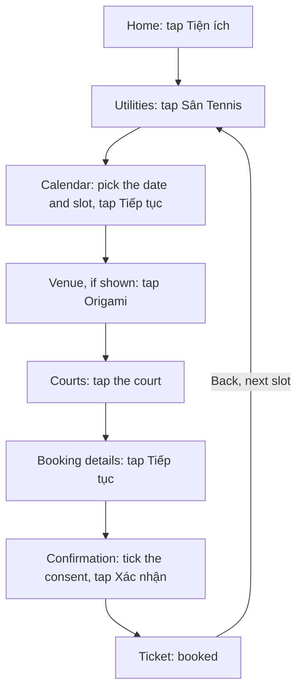
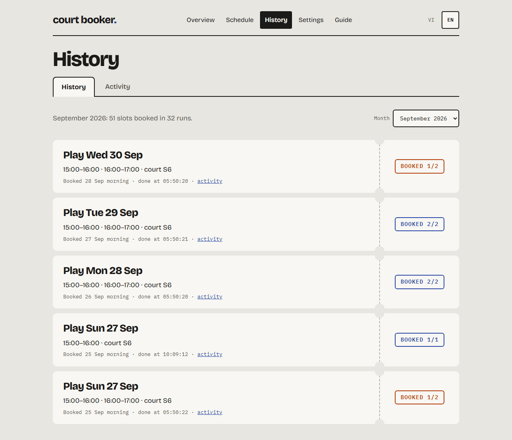
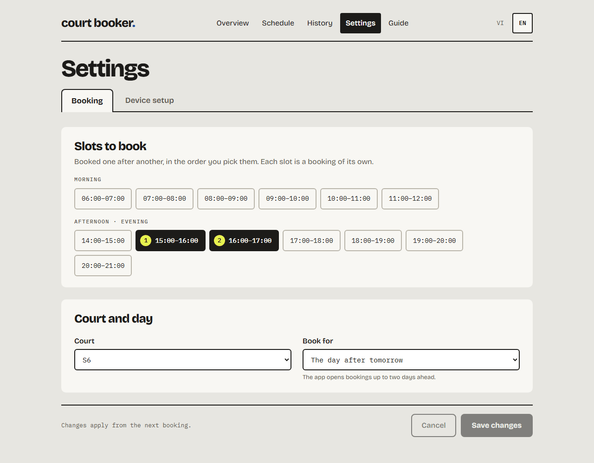

# vh-tennis-booker

[](https://github.com/servedbyhau/vh-tennis-booker/actions/workflows/ci.yml)


Books a tennis court the moment bookings open. The Vinhomes Resident app opens each day's
courts at 06:00, and the popular slots are gone within seconds. This project books them
while its owner sleeps: a Windows scheduled task wakes the PC, starts the MuMu Player
emulator and taps through the app's own booking screens with Python and uiautomator2, as a
person would. It uses no private API and does not modify the app.

It is a UI-automation case study built as a real product: a booking engine that has booked
real courts at 06:00 since 2026-10-10, a local FastAPI backend and a web UI in React and
TypeScript. Today it runs from the command line and, for the web UI, in a browser; a
packaged desktop app with an installer is the last step before 1.0.0.

> [!IMPORTANT]
> An educational, personal project, not affiliated with or endorsed by Vinhomes.


<sub>The web UI during a dry run. All screenshots show made-up data.</sub>

## Highlights

- **Unattended at 06:00.** The daily task wakes the PC from sleep, starts MuMu, restarts the
  app and waits on the utilities list. The run tells the time by NTP, on a counter Windows
  does not set, and the first tap goes out 0.1 s after 06:00:00.
- **Reports only what the app showed.** A slot counts as booked only once the app shows its
  ticket. A refusal fails the round with the app's own message, and a round that shows
  neither within 30 s is reported as "outcome unknown", never as booked.
- **Built for a slow app.** Each step taps as soon as its button appears, taps again every
  2 s while the app ignores it, and waits up to 30 s for a slow screen. A frozen emulator
  ends the run after 60 s with a
  clear error instead of hanging until the next morning.
- **One read per screen.** A screen is read in a single accessibility dump (about 70 ms)
  and every button is found in it locally; waiting for a screen and finding its buttons is
  the same read. At the real 06:00 opening, the first slot has been booked 7 to 11 s after
  06:00.
- **Local web UI and full history.** Overview, schedule, history and settings screens in
  Vietnamese and English, over a FastAPI backend on 127.0.0.1. Every run, slot and step is
  kept in SQLite (about 0.13 ms per write), beside a daily log of every screen read.
- **Tested without a device.** The Python tests replace the emulator, ADB, the clock and
  Task Scheduler with fakes, and the UI has component tests. CI runs Ruff, pytest on
  Python 3.9 to 3.14, and the UI's type check, lint, tests and build.

## How it works



The app is built with Flutter, which publishes its widgets to Android's accessibility tree
with their text in `content-desc`. The booker reads each screen in one dump, finds the
buttons by their Vietnamese labels and taps the coordinates from that dump; no position is
hard-coded. Each slot in `config.toml` is booked in its own round, and one Back from the
ticket returns to the utilities list for the next one. The labels live in `config.toml`,
so a change of wording in the app needs no code change.

A real 06:00 run, abridged (times are the PC clock, which was 0.161 s behind: the first
tap went out at 06:00:00.001 and is logged once the calendar showed):

```text
05:50:02.583 INFO    court-booker 0.6.1
05:50:02.718 INFO    Clock offset +0.161 s
05:50:04.894 INFO    Launching MuMu instance 0
05:50:29.704 INFO    Android started after 24.8 s
05:50:38.583 INFO    Ready on the home screen
05:59:00.694 INFO    Tapped 'Tiện ích'
05:59:59.839 INFO    Round 1/2: 15:00 - 16:00
06:00:01.427 INFO    Tapped 'Sân Tennis'
06:00:01.594 INFO    Selected date 2026-10-18
06:00:03.360 INFO    Selected slot 15:00 - 16:00 (0 swipe(s))
06:00:05.954 INFO    Tapped 'S6 - Sân tennis'
06:00:06.232 INFO    Confirmation page: 2026-10-18 15:00 - 16:00 on S6 - Sân tennis
06:00:06.439 INFO    Accepted terms
06:00:07.979 INFO    Booking confirmed
06:00:07.981 INFO    Round 2/2: 16:00 - 17:00
...
06:00:10.564 INFO      OK   15:00 - 16:00  booked  (8.1s)
06:00:10.564 INFO      FAIL 16:00 - 17:00  Court S6 - Sân tennis is fully booked  (2.6s)
```

Further reading:

- [docs/how-it-works.md](docs/how-it-works.md): reading a Flutter app from the outside,
  navigation, lessons learned
- [docs/architecture.md](docs/architecture.md): every module, backend route and UI layer
- [docs/field-notes.md](docs/field-notes.md): what the app and the emulator were seen to
  do, and the verified runs
- [docs/roadmap.md](docs/roadmap.md): product decisions, phases and the situations handled

## Quick start

### Requirements

- Windows (used on Windows 11) with [MuMu Player](https://www.mumuplayer.com/); ADB ships
  with MuMu
- The Vinhomes Resident app installed in MuMu and logged in
- Python 3.9 or later
- Node.js 22.12 or later, only for the web UI

### 1. Install

```bash
git clone https://github.com/servedbyhau/vh-tennis-booker.git
cd vh-tennis-booker
pip install -e ".[app]"            # "app" adds the backend of the web UI
cp config.example.toml config.toml
```

If `court-booker` is not found afterwards (Python's `Scripts` folder is not on `PATH`), use
`python -m court_booker` instead.

### 2. Configure

Edit `config.toml`, or later use Settings in the web UI. The keys you usually change:

| Key | Example | Meaning |
|---|---|---|
| `slots` | `["18:00 - 19:00", "19:00 - 20:00"]` | Slots to book, one round each, in this order: put the most wanted first |
| `court` | `"S10 - Sân tennis"` | The court, as the app names it (S6, S8, S9 or S10) |
| `days_ahead` | `2` | Book for today plus 0, 1 or 2 days (the app opens bookings two days ahead) |
| `start_at` | `"06:00"` | When the app opens bookings |
| `wake_at` | `"05:45"` | When the daily task wakes the PC and starts preparing |

Everything else (the app's labels, timeouts, the MuMu folder) has a working default,
explained in `config.example.toml`.

### 3. Set up the PC and the emulator

```bash
court-booker setup                         # check MuMu, its screen, wake timers and the app
court-booker setup --auto                  # fix what can be fixed
court-booker setup --auto --restart-mumu   # also restart a running MuMu to apply its screen
```

Auto setup saves the MuMu folder to `config.toml`, sets MuMu's screen to 540x1600 at
220 DPI (the whole slot list then fits without scrolling) and allows wake timers on mains
and battery. The rest is up to you:

- Keep the app logged in inside MuMu.
- Leave the PC on or in **Sleep**: a PC that is shut down cannot be woken.
- Keep it plugged in.
- Stay signed in to Windows (a locked screen is fine): MuMu needs the desktop session.

### 4. Try a dry run

```bash
court-booker --dry-run --at 14:05     # a time a few minutes from now
```

A dry run walks the whole flow and stops before "Xác nhận", so nothing is booked. Close MuMu
first to test the whole chain, as at 06:00. Exit code 4 usually means the app is logged
out.

### 5. Book every morning

```bash
court-booker schedule install   # daily task at wake_at; it books for real at start_at
court-booker schedule status    # the task, its last and next run
```

The Schedule screen of the web UI does the same with a switch, once a dry run has passed.
`court-booker schedule remove` deletes the task. A real run closes MuMu once its rounds are
done; the next run starts it again. A dry run leaves it open.

## Web UI

```bash
court-booker serve --config config.toml   # backend on http://127.0.0.1:8765, API docs at /api/docs
cd ui && npm ci && npm run dev            # then open http://localhost:5173
```

`--config config.toml` makes the UI read and save the same file as the command line. The
backend listens on 127.0.0.1 only, and the 06:00 run does not need it; watching a run in
the UI does not slow it down. Vietnamese is the default language, English is one click
away.

- **Tổng quan / Overview**: whether the next start is ready, or the one thing to do first;
  the next booking as a ticket; the last booking of each slot. During a run, its steps as
  they happen.
- **Hẹn giờ / Schedule**: a dry run (one must pass), then the daily switch that creates or
  removes the Windows task.
- **Lịch sử / History**: the courts booked, month by month, and the activity log of every
  run in plain steps, with the technical log one click away.
- **Cài đặt / Settings**: the slots, court and day to book; device setup, with an auto
  setup for what the app can fix.
- **Hướng dẫn / Guide**: four steps to start, what each screen is for, the usual problems.

An app not used yet opens on a four-step Welcome instead. Saving settings rewrites
`config.toml` (its comments are dropped); the next run reads it.

<p>
  
  
</p>

## Command line

| Command | What it does |
|---|---|
| `court-booker` | Book the slots in `config.toml` now |
| `court-booker --dry-run` | Walk the whole flow and stop before "Xác nhận" |
| `court-booker --at 06:00` | Prepare now, start booking at 06:00:00 |
| `court-booker --scheduled` | The same at `start_at` (what the daily task runs) |
| `court-booker --slots "18:00 - 19:00" --days 1` | Other slots or another day, for this run only |
| `court-booker --verbose` | Also print every screen read and every tap |
| `court-booker setup [--auto]` | Check the PC and the emulator, or fix them |
| `court-booker schedule install` / `status` / `remove` | The daily task |
| `court-booker serve --config config.toml` | The backend of the web UI |

Every command takes `--config` (default: `config.toml` in the current folder; for `serve`,
the one in the data folder).

| Exit code | Meaning |
|---|---|
| 0 | every round succeeded |
| 1 | a round failed |
| 2 | bad arguments or config, the start time has passed, or a dry run around the scheduled run |
| 3 | emulator or ADB error, or the emulator stopped answering (frozen) |
| 4 | the app did not reach its home screen (for example, logged out) |
| 5 | another run holds the run lock |
| 130 | interrupted with Ctrl+C |

- **Logs**: each run appends to `logs/court-booker-YYYY-MM-DD.log` beside `config.toml`,
  with every screen it read and every tap.
- **Data folder**: the history database `booker.db` and the run lock `run.lock` are in
  `%LOCALAPPDATA%\CourtBooker`; set `COURT_BOOKER_HOME` to move them.
- **One run at a time**: a second run is refused (exit code 5), and the scheduled run waits
  for a run already going, then stops it two minutes before the start time. No dry run or
  auto setup starts from `wake_at` to five minutes after `start_at`.

## Project layout

```text
src/court_booker/       booking engine and command line: emulator, ADB, flow, clock, history
src/court_booker/api/   FastAPI backend of the web UI
ui/                     web UI: React, TypeScript, Vite
tests/                  Python tests with a fake device, ADB, clock and Task Scheduler
tools/                  screen inspector, runner folder, OpenAPI export
docs/                   how it works, architecture, field notes, roadmap, design specs
```

[docs/architecture.md](docs/architecture.md) describes every module.

## Development

```bash
pip install -e ".[dev,app]"
pre-commit install
pytest
cd ui && npm ci && npm test
```

When the app changes its screens, `python tools/inspect_screen.py --near "Tôi đã hiểu"`
prints the elements around a label. [CONTRIBUTING.md](CONTRIBUTING.md) covers the checks,
conventions, branches and releases, and the runner folder that keeps the daily task off
work in progress.

## Roadmap

The 0.x versions go through four phases toward 1.0.0: it runs, it handles every situation,
it is fast, it is friendly to use. Now: 0.6.x fixes from the daily 06:00 logs. Then speed
tuning from the logs, and several accounts booking in parallel (one MuMu each). Last before
1.0.0: the desktop app with an installer. See [docs/roadmap.md](docs/roadmap.md) and the
[changelog](CHANGELOG.md).

## Credits

The UI ships the fonts [Bricolage Grotesque](https://github.com/ateliertriay/bricolage)
(© 2022 The Bricolage Grotesque Project Authors) and
[IBM Plex Mono](https://github.com/IBM/plex) (© 2017 IBM Corp.), both under the
[SIL Open Font License 1.1](https://openfontlicense.org), through the
[Fontsource](https://fontsource.org) packages.

## License

[MIT](LICENSE)
